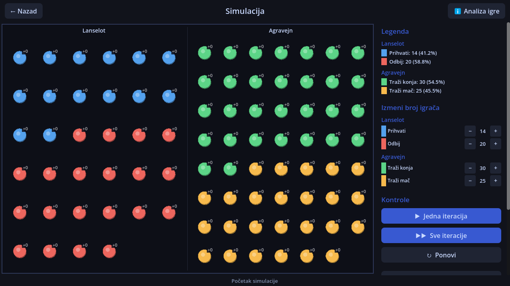
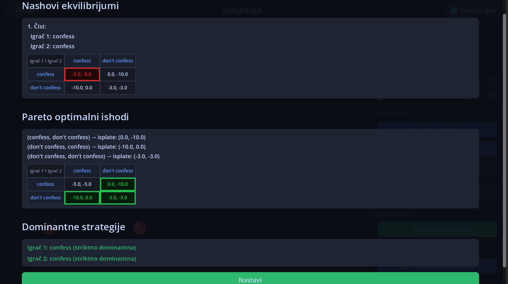
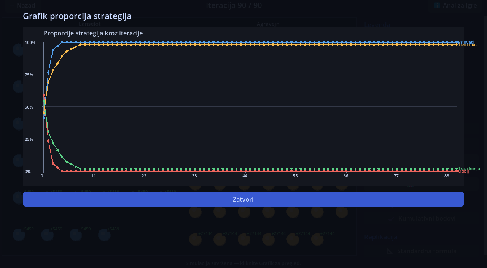

# Mixed Nash Equilibrium Simulator

An interactive Godot application for exploring simultaneous games and
population dynamics. It allows users to configure player types and payoff
matrices, then visualize a simulation over multiple generations.

This was a graduation project for a faculty program taught in Serbian.
The interface and in-app explanatory text were required to be in Serbian
and have been kept in their original language.

## Features in this repository

- Configure player types and give each type a name. The setup offers a
  choice of strategy counts, although the simulation currently uses two.
- Enter a 2-by-2 payoff matrix for each pair of player types.
- Watch a population of moving players interact over successive
  generations. Players of different types play against each other, and
  their payoffs are accumulated for the generation.
- Observe population changes: a player from the lowest-average-payoff
  type is replaced by a copy of a player from the highest-average-payoff
  type, when both are available.
- Follow the current generation, population size and percentages by
  player type in the simulation. The main menu also links to an in-app
  information screen.

## Features described in the thesis

The bachelor's thesis describes a **more complete version** than the
source currently published here. The following capabilities are described
in the thesis but are not implemented in the current repository:

- Symmetric and asymmetric two-player games with up to 10 strategies per
  player, named strategies and configurable initial populations.
- Game analysis showing pure and mixed Nash equilibria, Pareto-optimal
  outcomes and strictly or weakly dominant strategies.
- Single-step and run-all controls, reset, configurable iteration counts
  and a graph of strategy proportions over time.
- Cumulative or per-iteration scoring and a choice of replication modes:
  a standard discrete formula, per-strategy additions/removals, or
  rewarding the best and removing the worst.

### Screenshots from the thesis

These screenshots show the version described in the thesis, **not the
current repository implementation**.

**Simulation with two player types**

**Game analysis**

**Strategy proportions over time**

## Requirements

- Godot 4.6.1 **.NET** edition.
- .NET SDK 10.0.101 or a compatible later 10.0 SDK, as specified by
  `global.json`. The project targets .NET 8.

## Running the project

1. Import `project.godot` into the Godot .NET editor.
2. Build the C# project in the editor and run the main scene.
3. Use the Serbian interface to configure at least two player types and
   their payoff matrices, then start the simulation.

The `.godot/` directory contains generated editor and build files and is
not included in this repository.

## Current limitations

The code includes pure and 2-by-2 mixed equilibrium calculation helpers,
but the general equilibrium finder is a placeholder and the helpers are
not currently connected to the simulation. Expected mixed payoffs are also
placeholders. Although the setup allows more strategies, the payoff-entry
screen and simulation currently use two strategies per player type. The
simulation uses one matrix per pair and derives the second player's payoff
from the transposed entry; it does not accept independent payoffs for both
players. A one-type configuration has no opposing type to interact with.

## Project layout

- `scenes/` contains the Godot scenes and interface.
- `scripts/` contains the C# simulation and interface code.
- `docs/images/` contains screenshots extracted from the thesis.
- `project.godot` and `NashEquilibrium.csproj` contain project settings.
